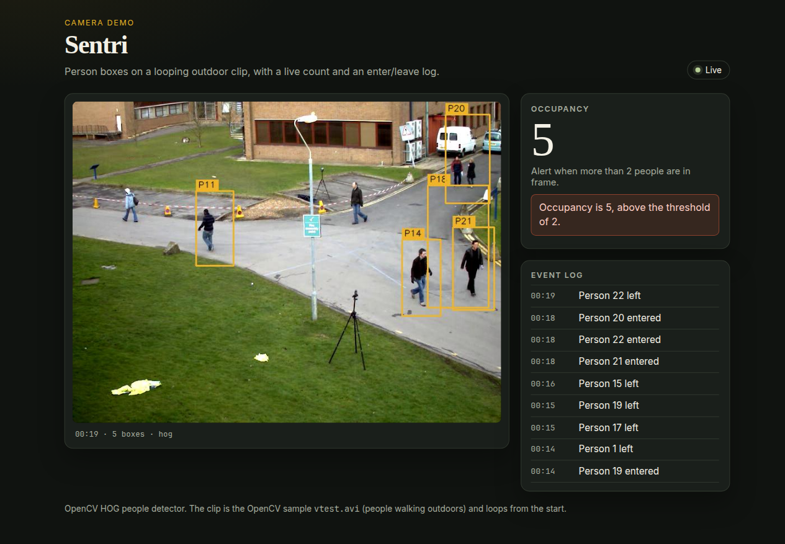

# Sentri

A small demo that plays one outdoor pedestrian clip, runs OpenCV’s built-in HOG people detector, and streams the annotated frames to a single-page dashboard.



The picture above is a frame from a local run of this app. The clip is looping, the WebSocket is connected, occupancy is 5, and the alert is on because that is greater than the threshold of 2.

## What works

- `scripts/fetch_sample.py` downloads OpenCV’s `samples/data/vtest.avi` from the 4.11.0 tag (Apache-2.0) and checks its SHA-256. The file is people walking outdoors past a building. It is not a store camera, and it is not committed (`demo-videos/*.avi` is gitignored).
- A FastAPI process reads that file in a loop.
- Detection is OpenCV 4.11’s default HOG+SVM people detector (`cv2.HOGDescriptor_getDefaultPeopleDetector`). `opencv-python-headless` is pinned to 4.11.0.86 because OpenCV 5 no longer provides `HOGDescriptor`.
- A centroid tracker keeps a box across frames. A person is announced after 3 sightings. They are marked left after 10 missed frames. Those events are “Person N entered” and “Person N left”.
- `GET /` serves the dashboard. `GET /health` reports detector, video path, threshold, and the current count.
- `WS /ws` sends JSON about 10 times a second: base64 JPEG, `count`, `boxes` (`id`, `x`, `y`, `w`, `h`), the recent `events`, and `alert` when `count > threshold`.
- The page shows the JPEG, the live count, the alert, and the event log.
- `pytest` covers the tracker, a blank-frame detector call, the HTTP page, the health check, and one WebSocket message. If the sample file is present it also checks that HOG finds a person in the first 20 frames. CI downloads the clip so that check runs there.
- `Dockerfile` builds an image that installs the requirements, downloads the clip, and starts uvicorn on port 8000.
- `.github/workflows/ci.yml` installs the requirements, downloads the clip, and runs pytest on Python 3.12.

Default alert threshold is 2 (`ALERT_THRESHOLD`). On this clip the count is often above that, so the alert is on for much of the loop.

## Limits

- `RTSP_URL` is still in `.env.example` and is not read. There is no live camera, and no entrance, aisle, or checkout split.
- There is no Next.js app, database, login, or saved alert history. Events live in memory and reset when the process stops. When the file loops, current tracks are closed and new ids are issued.
- YOLOv8 via `ultralytics` is not used. A current install pulls PyTorch and the CUDA wheels, which is a much larger stack than this demo. HOG needs no extra weight file.
- HOG misses people in this clip and sometimes draws a box that is not a person. The id in the log is the tracker’s id, not a stable identity; flickering boxes create extra enter/leave lines.
- Nothing here is deployed. GitHub Pages is not configured.

## Run

Python 3.12 is the version used for the tests and the Docker image.

```bash
python3.12 -m venv .venv
source .venv/bin/activate
pip install -r requirements.txt
python scripts/fetch_sample.py
uvicorn app.main:app --host 127.0.0.1 --port 8000
```

Open http://127.0.0.1:8000

Optional environment variables (`.env` is loaded if you create one from `.env.example`; existing variables win):

```bash
ALERT_THRESHOLD=2
VIDEO_PATH=demo-videos/sample.avi
```

Docker. The build downloads Python packages and the clip.

```bash
docker build -t sentri .
docker run --rm -p 8000:8000 sentri
```

That image was built and run locally. `GET /health` inside the container’s port returned `"status": "ok"` and a person count from this clip.

## Tests

```bash
pytest -q
```

Without the clip, `test_sample_clip_contains_a_person` is skipped. `python scripts/fetch_sample.py` makes it run.

## Layout

| Path | Role |
| --- | --- |
| `app/detector.py` | HOG people detector |
| `app/tracker.py` | Enter/leave tracking |
| `app/pipeline.py` | Video loop, JPEG, snapshot |
| `app/main.py` | FastAPI routes and WebSocket |
| `static/` | Dashboard page |
| `scripts/fetch_sample.py` | Download the clip |
| `tests/` | pytest |
| `Dockerfile` | Image that fetches the clip and serves the app |
| `.github/workflows/ci.yml` | Install, fetch, pytest |
